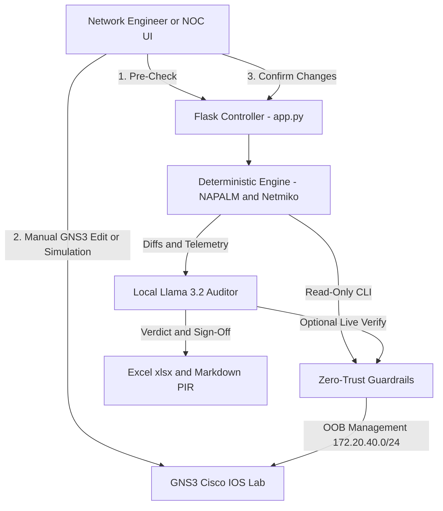
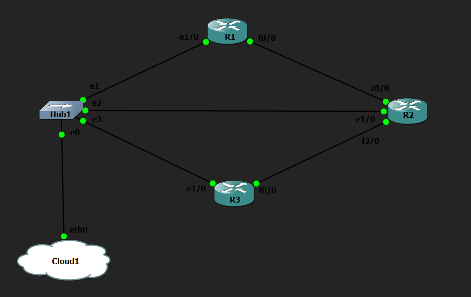
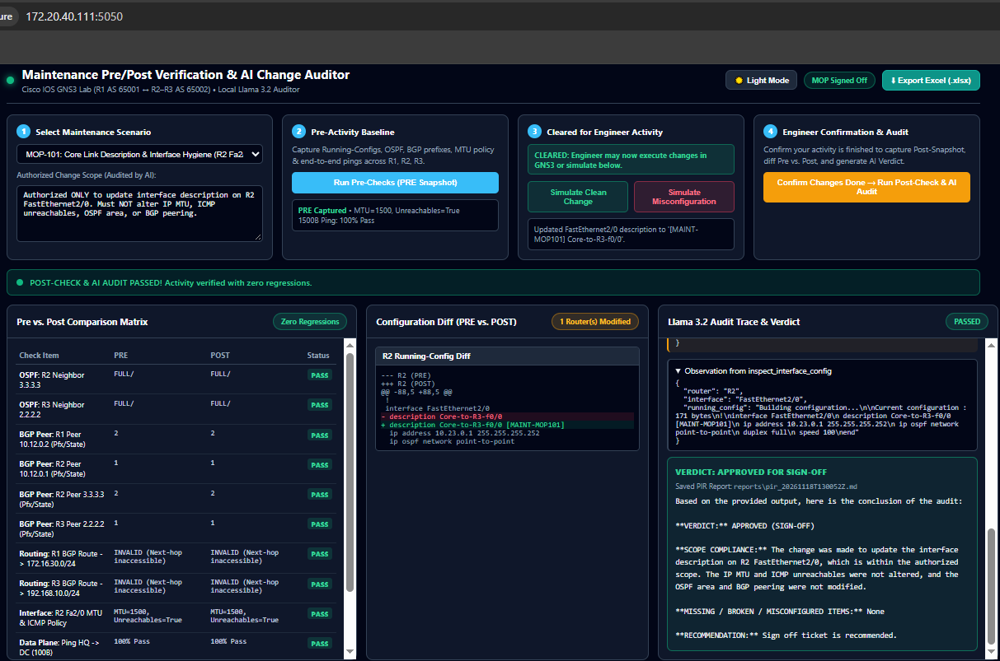
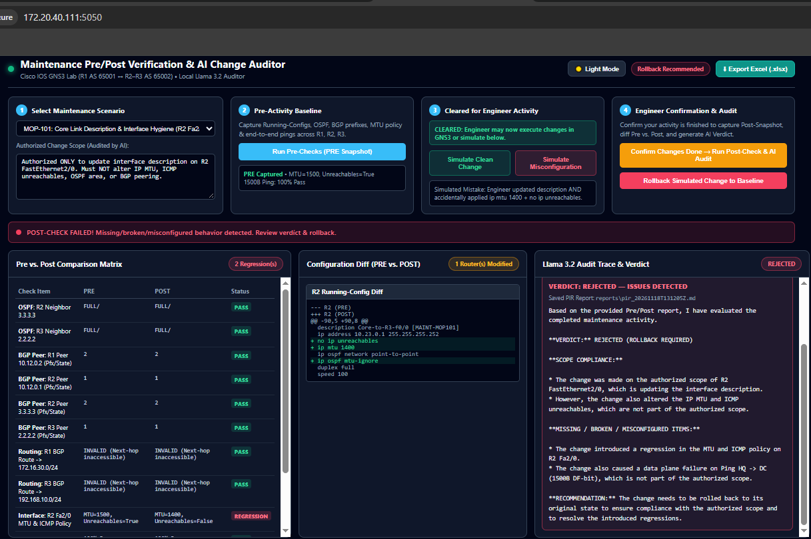
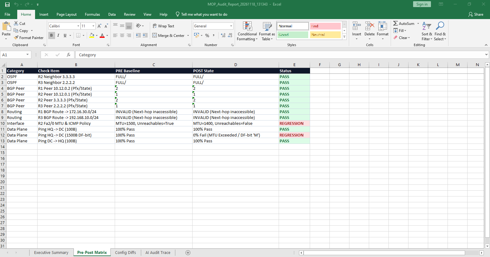

# netops-ai-mop-auditor


An autonomous, zero-trust **Pre/Post Maintenance Verification & AI Change Auditor** for **Cisco IOS** networks, powered by **Python, NAPALM, Netmiko, Flask, and local Llama 3.2 (via Ollama)** and validated inside **[GNS3](https://www.gns3.com/)**.

Built for Network, Telco, and SysOps engineers to eliminate manual change-window blind spots and detect "gray failures" (such as Path MTU blackholes, dropped BGP prefixes, or missing `next-hop-self`) before signing off a maintenance activity (MOP).

---

## Background & GNS3 Lab Setup Guide

This project is the **AIOps evolution** of my multi-part Python & **[GNS3](https://www.gns3.com/)** network automation series (built around `Hub1` and `Cloud1` out-of-band bridging so a local Python controller can automate virtual Cisco routers).

If you are reproducing this lab from scratch—or want to follow the progression from basic CLI scripting to a Flask-driven AI change auditor—start with these prerequisite guides:

| Step | Topic / Stack | LinkedIn Walkthrough |
| :--- | :--- | :--- |
| **1. Lab Setup** | GNS3 + VM Installation & Integration | [GNS3 2.1 GUI & VM Installation and Integration Steps for Windows 8/10 Platform](https://www.linkedin.com/pulse/gns3-21-gui-vm-installation-integration-steps-khurram-javed) |
| **2. Python Basics** | Raw Telnet Automation to Cisco IOS | [Network Automation (GNS3 Lab - Telnet to a Cisco Router using Python Script)](https://www.linkedin.com/pulse/network-automation-gns3-lab-telnet-cisco-router-using-khurram-javed) |
| **3. Secure CLI** | SSH Automation with **Netmiko** | [Network Automation: GNS3 Lab - SSH to a Cisco Router using Netmiko](https://www.linkedin.com/pulse/network-automation-gns3-lab-ssh-cisco-router-using-netmiko-javed) |
| **4. State & Config** | Structured Management with **NAPALM** | [Network Automation: GNS3 Lab - Configure a Cisco Router using NAPALM](https://www.linkedin.com/pulse/network-automation-gns3-lab-configure-cisco-router-using-javed) |
| **5. Web UI** | Inventory & Telemetry via **Nornir + Flask** | [Network Automation: Retrieve Device Facts & Interface Details using Nornir and Display on Webpage via Flask](https://www.linkedin.com/pulse/network-automation-retrieve-devices-facts-interface-details-javed) |
| **6. This Repo** | **AIOps Pre/Post Verification & Local Llama 3.2** | *Autonomous MOP Auditing, Deterministic Diffs & Guardrailed Sign-Off (`netops-ai-mop-auditor`)* |

---

## Use Case Description

Over 70% of network outages occur during scheduled maintenance windows. Traditional post-checks rely on basic `ping` or interface `up/up` checks, which routinely miss silent regressions—for example, when OSPF stays `FULL` and BGP stays `Established`, yet a misconfigured `ip mtu` or accidental BGP `network` removal silently breaks production traffic.

**`netops-ai-mop-auditor`** enforces a strict **4-Stage Maintenance Lifecycle**:
1. **Select Maintenance Scenario (MOP) & Scope:** Choose a planned activity (interface hygiene, new DC subnet onboarding, iBGP tuning, or a custom manual GNS3 edit) and inspect or edit the Authorized Change Scope.
2. **Pre-Activity Golden Baseline (`PRE_ACTIVITY`):** Deterministically snapshots running configurations, OSPF adjacencies, BGP peerings/prefix counts, critical route validity (`*>`), interface MTU/ICMP flags, and end-to-end data-plane pings (`100B` + `1500B DF-bit`) across all routers.
3. **Cleared for Engineer Activity:** Unlocks the engineer to perform changes—either **manually inside the GNS3 router console** or via **built-in clean/misconfigured simulation modes**.
4. **Manual Confirmation → Post-Check, AI Verdict & Export:** Upon engineer confirmation, captures `POST_ACTIVITY`, builds a deterministic **Pre vs. Post Comparison Matrix** and **Unified Config Diff**, and invokes a **local Llama 3.2 Change Auditor** to issue an **APPROVED (Sign-Off)** or **REJECTED (Rollback Required)** verdict—with one-click export to a **4-sheet Excel (`.xlsx`) workbook** and a **Markdown PIR report**, displayed in a **Dark / Light Mode** web UI.

---
## System Architecture


### Key Engineering Principles
- **Anti-Hallucination Split Design:** Python deterministically handles all config diffing (`difflib`), BGP/OSPF parsing, and data-plane probing; **Llama 3.2** audits those verified deltas against the authorized MOP scope.
- **Zero-Trust Read-Only Guardrails:** The AI agent has zero write tools. `guardrails.py` enforces a strict `show` / `ping` / `traceroute` prefix allowlist and regex-blocks `configure`, `reload`, `write`, and shell escapes.
- **100% Air-Gapped Local AI:** Uses local **Ollama (`llama3.2`)**, ensuring router configurations and operational telemetry never leave your management host.

---

## Included Maintenance Scenarios

| Scenario ID | Maintenance Activity | What It Validates |
| :--- | :--- | :--- |
| **MOP-101** | Core Link Description & Interface Hygiene (`R2 Fa2/0`) | Detects unexpected `ip mtu 1400`, `no ip unreachables`, or `ip ospf mtu-ignore` regressions via `1500B DF-bit` probing. |
| **MOP-102** | Onboard New DC App Subnet `172.16.40.0/24` (`R3`) | Verifies clean BGP onboarding without accidentally withdrawing existing `172.16.30.0/24` reachability. |
| **MOP-103** | Core iBGP Peer Policy Tuning (`R2` BGP AS `65002`) | Catches accidental removal of `neighbor 3.3.3.3 next-hop-self` causing inaccessible next-hops on `R3`. |
| **MOP-104** | Custom Live GNS3 Activity (Manual CLI) | Lets an engineer edit any router manually in GNS3 and audits all config diffs and routing impacts automatically. |

---

## GNS3 Lab Topology

Simulated in **[GNS3](https://www.gns3.com/)** ([Official GNS3 Documentation](https://docs.gns3.com/)) with an out-of-band management network (`Cloud1` ↔ `Hub1`) bridged to the Python automation host:



| Router | Role / AS | OOB Mgmt (`Hub1` → `Cloud1`) | Data-Plane Interfaces |
| :--- | :--- | :--- | :--- |
| **R1** | HQ Edge (`AS 65001`) | `172.20.40.211/24` (`e2/0`) | `Lo1: 192.168.10.1/24`, `Fa0/0: 10.12.0.1/30` |
| **R2** | Core ASBR (`AS 65002`) | `172.20.40.212/24` (`e1/0`) | `Fa0/0: 10.12.0.2/30`, `Fa2/0: 10.23.0.1/30` |
| **R3** | DC Edge (`AS 65002`) | `172.20.40.213/24` (`e1/0`) | `Fa0/0: 10.23.0.2/30`, `Lo1: 172.16.30.1/24` |

Clean baseline startup configs are provided in `labs/baseline-configs/` (`R1.cfg`, `R2.cfg`, `R3.cfg`).

---

## Repository Structure

```text
netops-ai-mop-auditor/
├── app.py                     # Flask API, workflow controller, SSE stream & Excel export
├── agent.py                   # Llama 3.2 Change Auditor & Markdown/JSON PIR exporter
├── tools.py                   # 4-layer Snapshot Engine, Pre/Post Matrix & Diff Engine
├── guardrails.py              # Zero-trust read-only CLI allowlist & Netmiko transport
├── inventory.py               # Router inventory & CMDB IP-to-device map
├── scenarios.py               # Planned Maintenance (MOP-101 to MOP-104) definitions
├── requirements.txt           # Python dependencies
├── labs/
│   └── baseline-configs/      # Clean R1.cfg, R2.cfg, R3.cfg startup configurations
├── docs/
│   └── screenshots/           # Topology, UI run captures & Excel report previews
├── templates/
│   └── index.html             # 4-Step Maintenance Console UI (Dark/Light + Excel export)
├── static/
│   └── style.css              # Dark/Light theme styling
├── LICENSE                    # GNU GPLv3 License
└── NOTICE                     # Third-party attributions & model/IOS disclaimers
```

---

## Installation

### Prerequisites
- **Python 3.10+**
- **[Ollama](https://ollama.com/download)** installed locally with **Llama 3.2**:
  ```bash
  ollama pull llama3.2
  ollama serve
  ```
- **[GNS3](https://www.gns3.com/)** running the 3-router Cisco IOS lab (`R1`, `R2`, `R3` powered on with `labs/baseline-configs/R1.cfg–R3.cfg` applied and your own licensed Cisco IOS image). *(For first-time GNS3 installation, see Step 1 in the setup table above.)*
- **Management Bridge (`Cloud1`):** Ensure the host/loopback adapter bound to `Cloud1 (eth0)` has an IP in `172.20.40.0/24` (e.g., `172.20.40.10/24`) so the Python controller can reach `172.20.40.211–213` directly at Layer 2 via `Hub1`.

### Setup Steps
```bash
# 1. Clone the repository
git clone https://github.com/shahkh-eng/netops-ai-mop-auditor.git
cd netops-ai-mop-auditor

# 2. Create and activate a virtual environment
python -m venv .venv
# Windows PowerShell:
.venv\Scripts\Activate.ps1
# Linux / macOS:
# source .venv/bin/activate

# 3. Install Python dependencies
pip install -r requirements.txt

# 4. (Optional) Override lab credentials or switch Telnet/SSH via environment variables
# Windows PowerShell:
$env:NET_USER="admin"
$env:NET_PASS="cisco123"
$env:NET_SECRET="cisco123"
$env:NET_USE_TELNET="true"   # Set "false" for SSHv2 (requires RSA keys on routers)
```

---

## Usage

1. Start the Flask web application:
   ```bash
   python app.py
   ```
2. Open your browser at **`http://127.0.0.1:5050`**.
3. Follow the 4-step Maintenance Workflow:
   - **Step 1:** Choose a scenario (`MOP-101` – `MOP-104`) and review or edit the Authorized Scope.
   - **Step 2:** Click **Run Pre-Checks (PRE Snapshot)** to lock the baseline and unlock engineer clearance.
   - **Step 3:** Execute changes manually in the GNS3 console or click **Simulate Clean Change** / **Simulate Misconfiguration**.
   - **Step 4:** Click **Confirm Changes Done → Run Post-Check & AI Audit** to inspect the Pre/Post Matrix, Unified Config Diff, and Llama 3.2 Verdict.
4. Click **⬇ Export Excel (`.xlsx`)** in the top-right header to download the 4-tab audit workbook (`Executive Summary`, `Pre-Post Matrix`, `Config Diffs`, `AI Audit Trace`), and toggle between **Dark / Light Mode** as preferred.

### Screenshots

**Approved MOP Run (UI):**


**Regression Caught & Rollback Triggered:**


**Exported 4-Tab Excel Audit Report:**


---

## Licensing Info & Disclaimer

- **Software License:** Distributed under the **GNU General Public License v3.0 (GPLv3)** — see [`LICENSE`](LICENSE) and [`NOTICE`](NOTICE) for details.
- **Local LLM Weights:** This repository does not redistribute AI model weights. Running `ollama pull llama3.2` downloads Meta Llama 3.2 separately under the [Meta Llama 3.2 Community License Agreement](https://www.llama.com/llama3_2/license/).
- **Cisco IOS & GNS3 Disclaimer:** Only user-authored plain-text configuration templates are included in `labs/baseline-configs/`. Users must supply their own lawfully licensed Cisco IOS images inside [GNS3](https://www.gns3.com/).
- **Usage Disclaimer:** Intended for lab validation and human-supervised change auditing. Always verify automated findings before executing changes in production networks.
